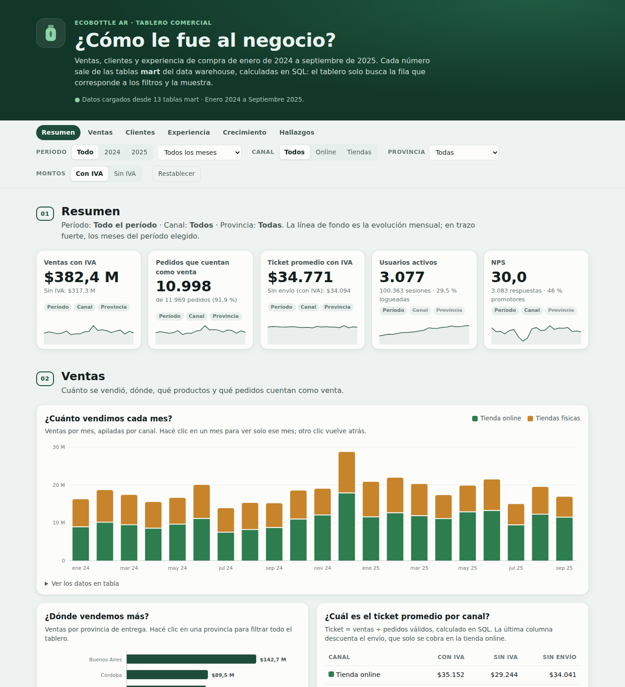

# EcoBottle AR — Data warehouse y tablero comercial

Trabajo práctico de **Introducción al Marketing Online y los Negocios Digitales**.

Se transforman los datos transaccionales de EcoBottle AR (`raw/`) en un **modelo estrella (Kimball)** con DuckDB, en un proceso **ELT**: los datos se cargan tal como vienen y las transformaciones se hacen en SQL. Sobre el modelo, una capa de **tablas mart** materializa los KPIs que monitorea el management (Ventas, Usuarios Activos, Ticket Promedio, NPS, Ventas por Provincia y Ranking Mensual por Producto), y un **tablero web** las publica.

- **Tablero:** [ezequielpiseri.github.io/practica-imond](https://ezequielpiseri.github.io/practica-imond/)
- **Consigna:** [Práctica](https://docs.google.com/document/d/15RNP3FVqLjO4jzh80AAkK6mUR5DOLqPxLjQxqvdzrYg/edit?usp=sharing)
- **Repositorio original:** [AugustoCarmona/practica-imond](https://github.com/AugustoCarmona/practica-imond)

```
raw/ (origen) ──► sql/ (ELT) ──► data/modelo_estrella/ ──► data/marts/ ──► tablero web (GitHub Pages)
                                  dimensiones y hechos      KPIs ya calculados   solo muestra
```

## Contenido

1. [Estructura del repositorio](#estructura-del-repositorio)
2. [Cómo ejecutarlo](#cómo-ejecutarlo)
3. [Modelo estrella](#modelo-estrella)
4. [Supuestos y decisiones](#supuestos-y-decisiones)
5. [Diccionario de datos](#diccionario-de-datos)
6. [Consultas clave (KPIs)](#consultas-clave-kpis)
7. [Capa de marts](#capa-de-marts)
8. [Validaciones](#validaciones)
9. [Tablero web](#tablero-web)
10. [Hallazgos](#hallazgos)

## Estructura del repositorio

```
raw/                         datos de origen (CSV, no se modifican)
sql/
  01_dimensiones.sql         10 dimensiones
  02_hechos.sql              6 tablas de hechos, con columnas de medida
  03_consultas.sql           validaciones, KPIs y consultas de hallazgos
  05_marts.sql               tablas mart: KPIs calculados por período, canal y provincia
data/
  modelo_estrella/           dimensiones y hechos exportados en CSV
    modelo_estrella.md       diagrama completo del modelo (generado)
  marts/                     tablas mart en CSV (fuente del tablero)
index.html                   tablero web (página publicada en GitHub Pages)
web/
  styles.css                 estilos del tablero
  app.js                     lee los marts, aplica los filtros y dibuja los gráficos
run_sql.py                   ejecuta los SQL, arma warehouse.duckdb y exporta data/
requirements.txt             dependencias (DuckDB)
assets/                      diagrama de las tablas de origen y captura del tablero
generator/                   generador de los datos de raw/ (referencia)
```

## Cómo ejecutarlo

Requisitos: Python 3.9 o superior y Git.

```bash
git clone URL-DE-ESTE-REPO
cd practica-imond
python -m venv .venv
source .venv/bin/activate          # Windows: .venv\Scripts\activate
pip install -r requirements.txt
python run_sql.py
```

`run_sql.py`:

1. Crea `warehouse.duckdb` desde cero.
2. Ejecuta los archivos de `sql/` en orden, y muestra en la terminal el resultado de cada consulta (validaciones, KPIs y controles de los marts).
3. Exporta las tablas a CSV: las `mart_*` a `data/marts/` y las dimensiones y hechos a `data/modelo_estrella/`.
4. Genera `data/modelo_estrella/modelo_estrella.md` con el diagrama del modelo.

Otros modos:

```bash
python run_sql.py --explorar   # consola sobre raw/ sin ejecutar sql/
python run_sql.py --ui         # arma el DW y abre la interfaz web de DuckDB
```

**Ver el tablero en local.** El navegador no deja leer los CSV si se abre `index.html` con doble clic. Hay que servir la carpeta:

```bash
python -m http.server 8000     # y abrir http://localhost:8000
```

## Modelo estrella

Diagrama simplificado (solo relaciones). El diagrama completo, con columnas y tipos, está en [`data/modelo_estrella/modelo_estrella.md`](./data/modelo_estrella/modelo_estrella.md).

```mermaid
erDiagram
    dim_date ||--o{ fact_sales_order : "order_date_key"
    dim_customer ||--o{ fact_sales_order : "customer_key"
    dim_channel ||--o{ fact_sales_order : "channel_key"
    dim_store ||--o{ fact_sales_order : "store_key"
    dim_province ||--o{ fact_sales_order : "province_key"
    dim_order_status ||--o{ fact_sales_order : "order_status_key"
    dim_payment_method ||--o{ fact_sales_order : "payment_method_key"

    dim_date ||--o{ fact_sales_order_item : "order_date_key"
    dim_product ||--o{ fact_sales_order_item : "product_key"
    dim_channel ||--o{ fact_sales_order_item : "channel_key"
    dim_province ||--o{ fact_sales_order_item : "province_key"

    dim_date ||--o{ fact_web_session : "date_key"
    dim_customer ||--o{ fact_web_session : "customer_key"
    dim_traffic_source ||--o{ fact_web_session : "traffic_source_key"
    dim_device ||--o{ fact_web_session : "device_key"

    dim_date ||--o{ fact_nps_response : "date_key"
    dim_customer ||--o{ fact_nps_response : "customer_key"
    dim_channel ||--o{ fact_nps_response : "channel_key"

    dim_date ||--o{ fact_payment : "order_date_key / paid_date_key"
    dim_payment_method ||--o{ fact_payment : "payment_method_key"
    dim_date ||--o{ fact_shipment : "order / shipped / delivered"
    dim_province ||--o{ fact_shipment : "province_key"
```



### Tablas de hechos y su grano

| Tabla | Una fila es… | KPI que alimenta |
|---|---|---|
| `fact_sales_order` | un pedido | Ventas, Ticket Promedio, Ventas por Provincia |
| `fact_sales_order_item` | un producto dentro de un pedido | Ranking por producto |
| `fact_payment` | un pago | Conciliación y rechazos de pago |
| `fact_shipment` | un envío por correo | Tiempos de entrega |
| `fact_web_session` | una visita a la web | Usuarios Activos |
| `fact_nps_response` | una respuesta de la encuesta NPS | NPS |

Hay dos hechos de ventas porque los KPIs piden dos granos distintos. El pedido tiene `total_amount`, con IVA y envío, que se usa para Ventas y Ticket. La línea tiene `line_total` por producto, que se usa para el Ranking. Bajar `total_amount` a nivel línea obligaría a repartir el envío entre productos con un criterio arbitrario.

## Supuestos y decisiones

**Reglas de negocio** (vienen del README original y se verificaron en los datos):

- **Venta válida:** pedido con estado `PAID` o `FULFILLED`. La regla está en un solo lugar, `dim_order_status.is_sale`, y se copia a los hechos como `is_sale` y `sales_amount`. Así no hay que repetir el filtro en cada consulta ni en cada medida.
- **Montos:** en pesos argentinos (ARS). `total_amount` = subtotal + IVA (21 %) + costo de envío. Ventas y Ticket se calculan sobre `total_amount`, como define la consigna. También se informan **sin IVA**: `total_amount − tax_amount`, es decir, se descuenta el impuesto y se mantiene el envío, que es ingreso de la empresa.
- **Canal:** un `store_id` vacío indica pedido online.

**Decisiones de modelado:**

- **Claves subrogadas** (`*_key`, números propios del DW) en todas las dimensiones. Las claves naturales (`*_id`) se conservan para trazabilidad.
- **Miembro "Desconocido" con clave `-1`:** cliente anónimo en sesiones y NPS, tienda en pedidos online ("Tienda online"), y valores faltantes de origen de tráfico y dispositivo. Así ninguna FK de dimensión queda nula y ningún JOIN pierde filas.
- **Fechas opcionales:** las de pago, despacho y entrega quedan `NULL` si el evento todavía no pasó. Ponerles `-1` equivaldría a inventar una fecha.
- **Provincia de la venta:** se toma de la dirección de envío. En las compras en tienda esa dirección es la de la tienda (4.443 de 4.683 pedidos offline). Las 240 ventas de tienda enviadas a domicilio se asignan a la provincia del cliente. Ningún pedido quedó sin provincia.
- **Usuarios Activos:** clientes logueados **distintos** en `web_session` durante el período. El 70 % de las sesiones son anónimas (70.751 de 100.363). La consigna sugiere contar `session_id` para los anónimos, pero eso mezcla dos unidades: un visitante con 10 visitas contaría como 10 usuarios. Por eso las sesiones anónimas se guardan, para analizar tráfico, pero no se cuentan como usuarios. **Consecuencia:** el KPI subestima la audiencia real; es "clientes identificados activos". Además, como es un conteo de distintos, no es sumable: la suma de los usuarios de cada mes no da los usuarios del año. Por eso se calcula en SQL para cada período (`mart_customer_kpi`): 3.077 clientes distintos en todo el período, y los de cada mes (MAU) en la serie mensual. La consulta B3b muestra también la forma de contar que sugiere la consigna, para comparar.
- **NPS:** promotores (9-10) menos detractores (0-6), sobre el total de respuestas, multiplicado por 100. La encuesta no tiene número de pedido, así que el NPS se cruza por cliente, canal y fecha de respuesta, no por pedido.
- **Los KPIs se calculan en SQL, no en la herramienta de visualización.** Cada hecho tiene columnas de medida preparadas (`sale_count`, `sales_net_amount`, `ticket_amount`, `active_customer_key`, `nps_points`) y la capa de marts materializa los KPIs para cada combinación de filtros. El tablero no suma, no promedia ni divide: busca la fila y la muestra.
- **Datos personales:** `dim_customer` no guarda email ni teléfono porque el tablero no los necesita (minimización de datos).
- **`dim_customer.province_name`:** la provincia donde el cliente recibe más pedidos, sin contar direcciones de tiendas. Queda vacía para los clientes que solo compraron en tienda.

## Diccionario de datos

Convenciones: `PK` = clave primaria, `FK` = clave foránea. Los importes son `DECIMAL(12,2)` en ARS. Las claves de fecha son enteros con formato `AAAAMMDD`.

### Dimensiones

**`dim_date`**: calendario del 01/01/2024 al 31/10/2025. Es una dimensión de rol: la usan las fechas de pedido, pago, despacho, entrega, sesión y NPS.

| Columna | Tipo | Descripción |
|---|---|---|
| `date_key` | INTEGER PK | Fecha como AAAAMMDD |
| `date` | DATE | Fecha |
| `year`, `quarter`, `month`, `day` | INTEGER | Partes de la fecha |
| `month_name` | VARCHAR | Enero … Diciembre |
| `year_month` | VARCHAR | `2024-01`; ordena bien como texto |
| `month_start` | DATE | Primer día del mes; eje de las series mensuales |
| `day_of_week` | INTEGER | 1 = lunes … 7 = domingo (ISO) |
| `day_name` | VARCHAR | Lunes … Domingo |
| `is_weekend` | BOOLEAN | Sábado o domingo |

**`dim_channel`**: canal de venta.

| Columna | Tipo | Descripción |
|---|---|---|
| `channel_key` | INTEGER PK | Clave subrogada |
| `channel_id` | INTEGER | Clave natural (`raw.channel`) |
| `code` | VARCHAR | `ONLINE` / `OFFLINE` |
| `name` | VARCHAR | Tienda Online / Tiendas Físicas |

**`dim_province`**: provincia de la venta.

| Columna | Tipo | Descripción |
|---|---|---|
| `province_key` | INTEGER PK | Clave subrogada (-1 = Desconocida) |
| `province_id` | INTEGER | Clave natural |
| `name` | VARCHAR | Buenos Aires, Córdoba, Santa Fe, Mendoza |
| `code` | VARCHAR | BA, CBA, SF, MZA |
| `iso_code` | VARCHAR | Código ISO 3166-2 (AR-B, AR-X, AR-S, AR-M); lo usa el mapa |
| `country_name` | VARCHAR | Argentina |

**`dim_store`**: tienda física.

| Columna | Tipo | Descripción |
|---|---|---|
| `store_key` | INTEGER PK | Clave subrogada (-1 = Tienda online) |
| `store_id` | INTEGER | Clave natural (NULL en la fila -1) |
| `name` | VARCHAR | Nombre de la tienda |
| `city`, `province_name` | VARCHAR | Ubicación de la tienda |
| `is_physical` | BOOLEAN | FALSE solo en la fila -1 |

**`dim_customer`**: cliente.

| Columna | Tipo | Descripción |
|---|---|---|
| `customer_key` | INTEGER PK | Clave subrogada (-1 = Anónimo) |
| `customer_id` | INTEGER | Clave natural |
| `full_name` | VARCHAR | Nombre y apellido |
| `status` | VARCHAR | Activo / Inactivo / Desconocido |
| `created_date` | DATE | Fecha de alta |
| `cohort_month` | VARCHAR | Mes de alta (AAAA-MM), para cohortes |
| `province_name` | VARCHAR | Provincia de entrega más frecuente |

**`dim_product`**: producto, con la jerarquía de categorías aplanada.

| Columna | Tipo | Descripción |
|---|---|---|
| `product_key` | INTEGER PK | Clave subrogada |
| `product_id` | INTEGER | Clave natural |
| `sku` | VARCHAR | Código de producto |
| `name` | VARCHAR | Classic A Bottle / Sport B Bottle |
| `category` | VARCHAR | Classic / Sport |
| `family` | VARCHAR | Bottles (categoría padre) |
| `list_price` | DECIMAL | Precio de lista sin IVA |

**`dim_order_status`**

| Columna | Tipo | Descripción |
|---|---|---|
| `order_status_key` | INTEGER PK | 1 a 5 |
| `status_code` | VARCHAR | CREATED, PAID, FULFILLED, CANCELLED, REFUNDED |
| `description` | VARCHAR | Descripción en castellano |
| `is_sale` | BOOLEAN | TRUE solo para PAID y FULFILLED |

**`dim_payment_method`**: `payment_method_key` (PK), `method_code` (CASH, CARD, TRANSFER, GATEWAY), `description`.

**`dim_traffic_source`**: `traffic_source_key` (PK, -1 = Desconocido), `source_code` (ads, direct, referral, organic), `description`, `is_paid` (TRUE para `ads`).

**`dim_device`**: `device_key` (PK, -1 = Desconocido), `device_code` (desktop, mobile, tablet), `description`.

### Hechos

**`fact_sales_order`**: un pedido.

| Columna | Tipo | Descripción |
|---|---|---|
| `order_id` | BIGINT PK | Número de pedido (dimensión degenerada) |
| `order_date_key` | INTEGER FK → dim_date | Fecha del pedido |
| `customer_key` | INTEGER FK → dim_customer | Cliente |
| `channel_key` | INTEGER FK → dim_channel | Canal |
| `store_key` | INTEGER FK → dim_store | Tienda (-1 si es online) |
| `province_key` | INTEGER FK → dim_province | Provincia de la dirección de envío |
| `order_status_key` | INTEGER FK → dim_order_status | Estado |
| `payment_method_key` | INTEGER FK → dim_payment_method | Medio de pago |
| `is_sale` | BOOLEAN | Cuenta como venta (PAID / FULFILLED) |
| `item_lines`, `units` | INTEGER | Cantidad de líneas y de unidades |
| `subtotal` | DECIMAL | Suma de `line_total`, sin IVA |
| `discount_amount` | DECIMAL | Descuentos del pedido |
| `tax_amount` | DECIMAL | IVA (21 % del subtotal) |
| `shipping_fee` | DECIMAL | Costo de envío |
| `total_amount` | DECIMAL | subtotal + IVA + envío |
| `sales_amount` | DECIMAL | `total_amount` si `is_sale`; si no, 0 |
| `sale_count` | INTEGER | 1 si `is_sale`; si no, 0. Su suma son los pedidos válidos |
| `sales_net_amount` | DECIMAL | `total_amount − tax_amount` si `is_sale`; si no, 0 (ventas sin IVA) |
| `ticket_amount` | DECIMAL | `total_amount` si `is_sale`; si no, NULL. Su promedio es el ticket |
| `ticket_net_amount` | DECIMAL | Igual que `ticket_amount`, sin IVA |

**`fact_sales_order_item`**: un producto dentro de un pedido. Repite las claves del pedido (fecha, canal, tienda, provincia, estado) para poder filtrarse igual que las ventas.

| Columna | Tipo | Descripción |
|---|---|---|
| `order_item_id` | BIGINT PK | Línea de pedido |
| `order_id` | BIGINT | Pedido (degenerada) |
| `product_key` | INTEGER FK → dim_product | Producto |
| `order_date_key`, `customer_key`, `channel_key`, `store_key`, `province_key`, `order_status_key` | INTEGER FK | Heredadas del pedido |
| `is_sale` | BOOLEAN | Heredado del pedido |
| `quantity` | INTEGER | Unidades |
| `unit_price` | DECIMAL | Precio unitario |
| `discount_amount` | DECIMAL | Descuento de la línea |
| `line_total` | DECIMAL | quantity × unit_price − descuento, sin IVA |
| `sales_line_total` | DECIMAL | `line_total` si `is_sale`; si no, 0 |

**`fact_payment`**: un pago.

| Columna | Tipo | Descripción |
|---|---|---|
| `payment_id` | BIGINT PK | Pago |
| `order_id` | BIGINT | Pedido |
| `order_date_key` | INTEGER FK → dim_date | Fecha del pedido |
| `paid_date_key` | INTEGER FK → dim_date | Fecha de cobro (NULL si no se cobró) |
| `channel_key`, `payment_method_key` | INTEGER FK | Canal y medio de pago |
| `payment_status` | VARCHAR | PENDING, PAID, FAILED, REFUNDED |
| `amount` | DECIMAL | Monto |
| `minutes_to_pay` | INTEGER | Minutos entre el pedido y el cobro |

**`fact_shipment`**: un envío por correo.

| Columna | Tipo | Descripción |
|---|---|---|
| `shipment_id` | BIGINT PK | Envío |
| `order_id` | BIGINT | Pedido |
| `order_date_key`, `shipped_date_key`, `delivered_date_key` | INTEGER FK → dim_date | Pedido, despacho y entrega (las dos últimas pueden ser NULL) |
| `channel_key`, `store_key`, `province_key` | INTEGER FK | Heredadas del pedido |
| `carrier` | VARCHAR | Correo |
| `shipment_status` | VARCHAR | READY, SHIPPED, DELIVERED, CANCELLED |
| `hours_to_ship` | DECIMAL | Horas entre el pedido y el despacho |
| `days_to_deliver` | DECIMAL | Días entre el despacho y la entrega |
| `days_order_to_door` | DECIMAL | Días entre el pedido y la entrega |

**`fact_web_session`**: una visita a la web.

| Columna | Tipo | Descripción |
|---|---|---|
| `session_id` | BIGINT PK | Sesión |
| `date_key` | INTEGER FK → dim_date | Fecha de inicio |
| `customer_key` | INTEGER FK → dim_customer | Cliente (-1 = anónimo) |
| `traffic_source_key` | INTEGER FK → dim_traffic_source | Origen de la visita |
| `device_key` | INTEGER FK → dim_device | Dispositivo |
| `is_logged_in` | BOOLEAN | El visitante inició sesión |
| `duration_seconds` | INTEGER | Duración (NULL si no tiene fin registrado) |
| `active_customer_key` | INTEGER | `customer_key` si está logueado; NULL si es anónimo. Su recuento distinto son los usuarios activos |

**`fact_nps_response`**: una respuesta de la encuesta.

| Columna | Tipo | Descripción |
|---|---|---|
| `nps_id` | BIGINT PK | Respuesta |
| `date_key` | INTEGER FK → dim_date | Fecha de respuesta |
| `customer_key` | INTEGER FK → dim_customer | Cliente (-1 = anónimo) |
| `channel_key` | INTEGER FK → dim_channel | Canal |
| `score` | SMALLINT | Puntaje de 0 a 10 |
| `nps_group` | VARCHAR | Promotor / Pasivo / Detractor |
| `is_promoter`, `is_passive`, `is_detractor` | INTEGER | Indicadores 1/0 para calcular el NPS |
| `has_comment` | BOOLEAN | Dejó comentario |
| `comment` | VARCHAR | Texto del comentario |
| `nps_points` | INTEGER | +100 promotor, 0 pasivo, −100 detractor. Su promedio es el NPS |

## Consultas clave (KPIs)

Están todas en [`sql/03_consultas.sql`](./sql/03_consultas.sql), parte B. Las más importantes:

**Ventas y Ticket Promedio**

```sql
SELECT
    SUM(sales_amount)                                   AS ventas,
    SUM(sales_amount) / COUNT(*) FILTER (WHERE is_sale) AS ticket_promedio
FROM fact_sales_order;
```

**Usuarios Activos por mes**

```sql
SELECT d.year_month, COUNT(DISTINCT w.customer_key) AS usuarios_activos
FROM fact_web_session AS w
JOIN dim_date AS d ON d.date_key = w.date_key
WHERE w.is_logged_in
GROUP BY d.year_month;
```

**NPS**

```sql
SELECT (SUM(is_promoter) - SUM(is_detractor)) * 100.0 / COUNT(*) AS nps
FROM fact_nps_response;
```

**Ventas por provincia**

```sql
SELECT p.name, SUM(f.sales_amount) AS ventas
FROM fact_sales_order AS f
JOIN dim_province AS p ON p.province_key = f.province_key
GROUP BY p.name;
```

**Ranking mensual por producto**

```sql
SELECT d.year_month, p.name, i.product_key,
       SUM(i.sales_line_total) AS ventas,
       RANK() OVER (PARTITION BY d.year_month ORDER BY SUM(i.sales_line_total) DESC) AS puesto
FROM fact_sales_order_item AS i
JOIN dim_date    AS d ON d.date_key    = i.order_date_key
JOIN dim_product AS p ON p.product_key = i.product_key
GROUP BY d.year_month, p.name, i.product_key;
```

### Resultados del período completo (01/2024 a 09/2025)

| KPI | Con IVA | Sin IVA |
|---|---|---|
| Ventas | $382,4M | $317,3M |
| Pedidos válidos | 10.998 de 11.969 | |
| Ticket promedio | $34.771 | $28.854 |
| Ticket online / tiendas físicas | $35.152 / $34.229 | $29.244 / $28.298 |
| Usuarios activos (clientes logueados distintos en todo el período) | 3.077 | |
| NPS | 30,0 | |

El ticket online es más alto porque incluye el envío, que en tienda no se cobra: sin envío, los dos canales quedan casi iguales ($34.041 online y $34.170 en tiendas).

## Capa de marts

`sql/05_marts.sql` calcula los KPIs a partir del modelo estrella y los **materializa** en tablas que el tablero consume directamente.

**Por qué una fila por cada combinación de filtros.** Un promedio o un recuento distinto no se puede volver a agregar: el ticket de 2025 no es el promedio de los tickets de cada mes, y los usuarios del año no son la suma de los usuarios de cada mes. Por eso cada mart trae, ya calculada, cada combinación que ofrece el tablero:

- **Período:** el total (`Todo`), cada año y cada mes. Una vista temporal repite cada fecha en sus tres períodos, así un solo `GROUP BY` calcula los tres niveles.
- **Canal y provincia:** `GROUP BY ... CUBE (channel, province)` genera todas las combinaciones, incluidos los totales `Todos` y `Todas`, calculados desde los hechos y no sumando filas.

| Tabla | Una fila es… | Qué trae |
|---|---|---|
| `mart_sales_kpi` | período × canal × provincia | ventas con y sin IVA, pedidos totales y válidos, ticket con y sin IVA y sin envío |
| `mart_order_status` | período × canal × provincia × estado | pedidos y monto por estado, con `is_sale` |
| `mart_sales_product` | período × canal × provincia × producto | unidades, ventas de línea, puesto y participación |
| `mart_product_leaders` | un producto | meses en que fue el primero en pesos y en unidades |
| `mart_customer_kpi` | período | usuarios activos, sesiones y % de sesiones logueadas |
| `mart_session_mix` | período × apertura × valor | sesiones por origen de tráfico y por dispositivo |
| `mart_nps_kpi` | período × canal | respuestas, promotores, pasivos, detractores y NPS |
| `mart_nps_group` | período × canal × grupo | lo mismo en formato largo, para el gráfico de anillo |
| `mart_delivery_kpi` | período × canal × provincia | envíos entregados, días en el correo, días del pedido a la puerta, percentil 90 y % de más de 7 días |
| `mart_payment_kpi` | período × canal × medio de pago | pagos, rechazos y tasa de rechazo |
| `mart_growth` | un KPI | enero a septiembre 2024 contra 2025 y la variación (en puntos para el NPS) |
| `mart_dim_period`, `mart_dim_channel`, `mart_dim_province` | un valor de filtro | etiqueta y orden de cada opción de los filtros |

Usuarios y sesiones no tienen canal ni provincia (todas las visitas son web y sin ubicación), y el NPS no tiene provincia (la encuesta no tiene pedido): esos marts no traen esas columnas y el tablero lo indica.

## Validaciones

La parte A de `03_consultas.sql` verifica que el modelo cuadre con `raw/`:

| Control | Resultado |
|---|---|
| Cada hecho tiene las mismas filas que su tabla de origen | ✅ 6 de 6 |
| Ventas del DW = ventas calculadas directo sobre `raw.sales_order` | ✅ $382.410.636 en ambos |
| Pedidos sin provincia asignada | ✅ 0 |
| Pedidos cuyas líneas no suman el subtotal | ✅ 0 |
| Claves foráneas válidas | ✅ DuckDB rechaza la carga si alguna falla |
| Columnas de medida = fórmula de cada KPI, en total y por canal (A5) | ✅ |
| Marts = modelo estrella: ventas, pedidos, meses que suman el total, estados, productos, usuarios, sesiones, NPS, entregas y pagos (controles de `05_marts.sql`) | ✅ 11 de 11 |

## Tablero web

**[ezequielpiseri.github.io/practica-imond](https://ezequielpiseri.github.io/practica-imond/)** · HTML, CSS y JavaScript sin librerías, publicado con GitHub Pages desde la raíz del repositorio.



El tablero lee los CSV de `data/marts/`, busca la fila que corresponde a los filtros elegidos y la dibuja. **No suma, no promedia ni divide valores de negocio:** todos los KPIs vienen calculados del SQL.

### Secciones

| Sección | Qué responde | Mart |
|---|---|---|
| Resumen | Ventas, pedidos válidos, ticket, usuarios activos y NPS del período, con su evolución mensual | `mart_sales_kpi`, `mart_customer_kpi`, `mart_nps_kpi` |
| Ventas | Ventas por mes y canal; por provincia; ticket por canal (con IVA, sin IVA y sin envío); ventas por producto y reparto; pedidos por estado; rechazo de pagos | `mart_sales_kpi`, `mart_sales_product`, `mart_order_status`, `mart_payment_kpi` |
| Clientes | Usuarios activos por mes; sesiones por origen y dispositivo | `mart_customer_kpi`, `mart_session_mix` |
| Experiencia | Distribución del NPS; NPS mensual por canal; tiempos de entrega | `mart_nps_group`, `mart_nps_kpi`, `mart_delivery_kpi` |
| Crecimiento | Enero a septiembre 2024 contra 2025 | `mart_growth` |
| Hallazgos | Los hallazgos de abajo; cada tarjeta lleva al gráfico que la respalda. Los números del texto también se leen de los marts; la interpretación es texto de análisis | todos los anteriores y `mart_product_leaders` |

### Filtros e interacción

| Filtro | Afecta a | No afecta a |
|---|---|---|
| Período (total, año o mes) | Todo, salvo Crecimiento | Crecimiento (compara períodos fijos) |
| Canal | Ventas, productos, estados, pagos, NPS y entregas | Usuarios y sesiones: todas las visitas son web |
| Provincia | Ventas, productos, estados y entregas | Usuarios, sesiones, NPS y pagos: no tienen provincia |
| Con / sin IVA | Ventas y ticket | El resto |

- Cada tarjeta del Resumen indica qué filtros le aplican.
- Las series mensuales muestran siempre todos los meses y resaltan los del período elegido.
- Clic en un mes del gráfico de ventas: filtra ese mes. Clic en una provincia: filtra esa provincia.
- Pasar el mouse por los gráficos muestra los valores; las ventas por mes tienen además una tabla de datos.
- Diseño adaptable a celular y modo oscuro según la configuración del sistema.

**Publicación.** En GitHub: *Settings → Pages → Deploy from a branch → `main` / `(root)`*. Para actualizar los datos se corre `python run_sql.py` y se suben los CSV de `data/marts/`; el tablero no necesita cambios.

## Hallazgos

Las consultas están en la parte C de `03_consultas.sql`. Se distinguen **hechos**, que salen directo de los datos, de **interpretaciones**, que son hipótesis para validar.

1. **En julio y agosto de 2024 el NPS online se desplomó por la demora del correo.** *(Hecho, consulta C7)* El tiempo de despacho a entrega pasó de 3,2–3,9 días (enero a junio) a 7,4 días en julio y 8,0 en agosto. En esos mismos meses el NPS online cayó de 29,2 (junio) a −6,0 (julio) y −26,5 (agosto). Se recuperó cuando volvieron los tiempos normales: −1,9 en septiembre y 31,9 en octubre. El NPS de las tiendas físicas, que no usan envío, no cayó (46,2 en agosto). Los comentarios más repetidos de los detractores online de esos dos meses son "El envío demoró y nadie me avisó", "Tardó mucho más de lo esperado" y "Llegó con la caja dañada". Todos los envíos van por un único correo (Correo Argentino). *(Interpretación, confianza alta)* La caída se explica por la demora de entrega, no por el producto: coinciden las fechas, el canal sin envío funciona como grupo de control y los comentarios lo dicen textualmente. No se puede probar respuesta por respuesta porque la encuesta no tiene número de pedido. **Recomendación:** tener un segundo correo como alternativa y avisar al cliente cuando el envío se demora; "nadie me avisó" sugiere que la falta de aviso empeora la opinión tanto como la demora.

2. **La venta crece por más clientes, no por compras más caras, y todo el crecimiento es online.** *(Hecho, consulta C8)* Comparando enero a septiembre de cada año, las ventas subieron 16,6 % ($146,3M a $170,6M). Los pedidos válidos subieron 16,9 % (4.196 a 4.906) y los clientes identificados que compraron, 39 % (1.624 a 2.264). El ticket promedio quedó estable ($34,87K a $34,78K, −0,3 %). Las ventas online pasaron de $81,2M a $105,3M (+30 %) y las tiendas quedaron planas ($65,1M contra $65,3M). *(Interpretación)* El negocio crece captando clientes por el canal online, no subiendo precios ni el gasto por compra. Como los clientes crecieron más que los pedidos, cada cliente compró en promedio menos veces (2,6 a 2,2 pedidos), lo que es esperable si muchos son nuevos; conviene seguir la recompra. Si las tiendas justifican su costo no se puede evaluar: no hay datos de costos.

3. **El NPS online es más bajo que el de las tiendas y varía por provincia.** *(Hecho)* NPS del período: tiendas físicas 40,9 contra online 24,0. Por provincia del cliente, el NPS online es 35 en Buenos Aires y entre 14 y 19 en Córdoba, Mendoza y Santa Fe; Buenos Aires también tiene los envíos más rápidos (4,0 días del pedido a la puerta, contra 5,7 a 6,0 en las otras). *(Interpretación)* Por sí sola, esta es una correlación entre 4 provincias. Pero el hallazgo 1 muestra el mismo mecanismo en el tiempo, con un grupo de control, así que la hipótesis "la demora del envío baja el NPS" queda bastante respaldada.

4. **Mercado Pago rechaza el doble que la tarjeta.** *(Hecho)* Fallan el 9,8 % de los pagos por pasarela contra el 4,0 % con tarjeta. Las cancelaciones suman 658 pedidos, $22,5M que no se concretaron. *(Interpretación)* Es un punto concreto para recuperar ventas: reintentos o un medio alternativo al momento del rechazo.

5. **Los usuarios activos se duplicaron; la mayoría del tráfico es anónimo y desde el celular.** *(Hecho, consultas B3, C4 y C9)* Los clientes logueados por mes pasaron de 424 (01/2024) a 1.041 (09/2025), y la proporción de sesiones logueadas subió del 21 % al 34 %. El 61,9 % de las visitas es desde el celular, 32,3 % desde computadora y 5,8 % desde tablet. *(Interpretación)* Parte del crecimiento del KPI puede deberse a que más gente inicia sesión, no a que haya más audiencia: el KPI mide clientes identificados, no visitantes. Con 6 de cada 10 visitas desde el celular, la experiencia móvil (incluido el pago) es prioritaria.

6. **Los productos se reparten casi parejo.** *(Hecho)* Sport B lidera en pesos en 12 de los 21 meses, por su precio más alto ($15.000 contra $12.000). Classic A vende más unidades en 15 de los 21 meses. El puesto 1 alterna mes a mes. *(Interpretación)* Con dos productos, un "top N" dice poco: por eso el tablero muestra los dos productos lado a lado cada mes en lugar de solo el primero.

**Ideas para sumar:** tasa de conversión de sesión a pedido por origen de tráfico (requiere vincular sesión y pedido, que hoy no se puede) y, para medir el NPS por pedido, agregar `order_id` a la encuesta. Los días de entrega junto al NPS online y la tasa de rechazo por medio de pago ya están en el tablero.
